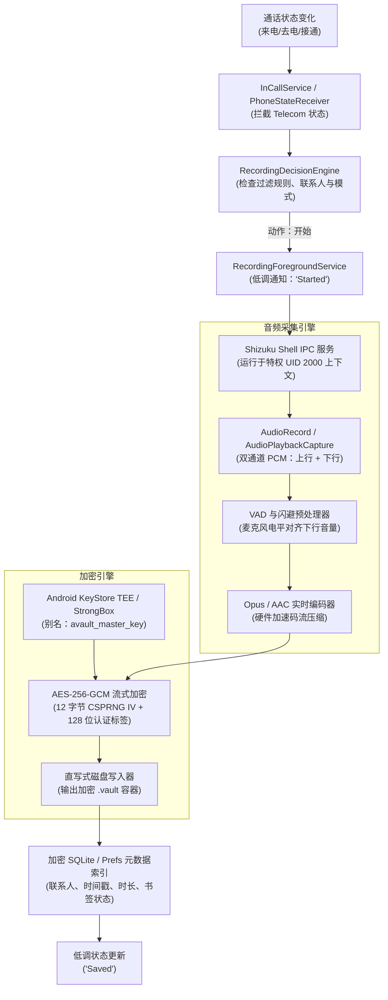

<div align="center">

# AVault · 通话录音与加密保险箱 · 中文版

**无需 Root，在 Android 12 – 16+ 上实现硬件级 AES-256-GCM 加密的通话录音与本地加密保险箱。**

> ⚠️ **本仓库是 [arpanjot-coding/AVault](https://github.com/arpanjot-coding/AVault) 的中文翻译**，仅翻译文档、不含代码。项目版权归原作者所有，遵循 MIT License。下载 APK、提交 Issue、Star 请前往[原仓库](https://github.com/arpanjot-coding/AVault)。

[](https://github.com/arpanjot-coding/AVault/releases/latest)
[](LICENSE-original)
[](https://developer.android.com)
[](#-二进制格式与加密规格)
[](https://shizuku.rikka.app)

🌐 [官方网站与文档](https://arpanjot-coding.github.io/AVault/) · 📦 [直接下载 APK (v2.0.0)](https://github.com/arpanjot-coding/AVault/releases/download/v2.0.0/AVault-v2.0.0-debug.apk)

</div>

---

## ⚠️ 学术与安全研究用途声明（务必阅读）

> [!WARNING]
> ### 本项目严格限于学术、安全与教育研究用途
>
> **责任限制与免责：**
> AVault 的作者、维护者、贡献者与版权持有人，对因编译、安装、运行、修改或分发本软件而产生的任何损害、法律索赔、刑事处罚或民事诉讼，**不承担任何责任**。
>
> - **通话录音与电信合规：** 各国/各地区对通话录音与通信拦截的法律差异巨大——有的实行**单方同意**（如美国 18 U.S.C. § 2511），有的实行**各方同意**（如加州刑法 § 632、德国 StGB § 201、GDPR 第 6 条）。在中国大陆，私人录音的法律效力与合规边界同样因场景而异，请自行了解并遵守所在司法辖区的法规。
> - **用户责任：** 编译或运行 AVault 的人，对确定并遵守所有适用的地方/国家/国际隐私法规负有全部责任。
> - **禁止恶意监听：** 本代码库绝不得用于未经授权的电子监听、窃听、间谍活动、跟踪或骚扰。
>
> 克隆、构建或使用本仓库，即表示你确认将对自身行为独立负责，并同意 herein 提供的 **MIT License** 条款。

---

## 📑 目录

- [项目摘要与架构亮点](#%EF%B8%8F-项目摘要与架构亮点)
- [能力与安全对比矩阵](#-能力与安全对比矩阵)
- [二进制格式与加密规格](#-二进制格式与加密规格)
- [快速开始：AI 一句话自动部署（推荐）](#-快速开始ai-一句话自动部署推荐)
- [手动构建与部署](#%EF%B8%8F-手动构建与部署)
- [Shizuku 免 Root 特权提供方配置](#%EF%B8%8F-shizuku-免-root-特权提供方配置)
- [系统架构与数据流](#-系统架构与数据流)
- [核心功能详解](#-核心功能详解)
- [配置项参考](#%EF%B8%8F-配置项参考)
- [威胁模型与安全分析](#%EF%B8%8F-威胁模型与安全分析)
- [诊断与故障排除](#-诊断与故障排除)
- [常见问题](#-常见问题)
- [许可证](#%EF%B8%8F-许可证)

---

## 🏛️ 项目摘要与架构亮点

**AVault** 是一个开源、以安全为核心的电信管理平台与加密语音保险箱，面向 Android 12 至 16+ 的现代设备。

传统通话录音应用把原始音频以未加密的 `.mp3` / `.m4a` 形式存在公共存储目录里——任何拥有媒体读取权限的第三方 App、媒体索引器、以及未授权的物理提取，都能读到这些敏感通话内容。

AVault 的解法是组合拳：**免 Root 的系统级电信集成**（经特权 ADB shell Binder IPC）+ **硬件 AES-256-GCM 加密** + **零明文瞬时播放** + **多因素生物识别锁** + **自动化生命周期留存管理**。

### 五大支柱

1. **硬件隔离主密钥：** 密钥在设备的安全硬件模块（TEE / StrongBox Keymaster）内经由 Android KeyStore Provider 生成，密钥原始材料永不进入用户态内存。
2. **零明文瞬时播放：** 解密即时发生在易失性内存中的一个隔离 POSIX 文件描述符（权限 `0600`）里，并以 `.nomedia` 阻止索引；播放停止的瞬间，临时流即被密码学粉碎。
3. **多因素应用锁：** 生物识别（指纹/面容/设备凭据）+ 加盐 PBKDF2/SHA-256 PIN 引擎，带指数级暴力破解退避保护。
4. **自动化存储生命周期：** 过期且未加书签的录音自动清理（1 天到 1 年可配），加书签的通话永久保留、免疫清理。
5. **隐身与极简呈现：** 屏蔽通话结束 Toast，仅使用低调状态提示（`"Started"` / `"Saved"`），并启用 `FLAG_SECURE` 防截屏、防任务切换器预览。

---

## 📊 能力与安全对比矩阵

| 功能 / 安全控制 | 传统录音 App | Root 方案（Magisk/KSU） | **AVault** |
| :--- | :---: | :---: | :---: |
| **需要 Root** | ❌ 否 | ⚠️ **是（需解锁 Bootloader）** | 🛡️ **否（免 Root ADB / Shizuku）** |
| **Android 12 – 16+ 兼容** | ❌ 被 Scoped Storage 破坏 | ⚠️ 需自定义内核 | ✅ **原生支持（API 31 – 36）** |
| **磁盘存储格式** | 明文 MP3/M4A/WAV | 明文 MP3/WAV | 🔒 **认证加密 AES-256-GCM（`.vault`）** |
| **主密钥保护** | 无（不加密） | 无（不加密） | 🔒 **硬件 HSM / TEE / StrongBox** |
| **明文播放暴露** | 永久明文文件 | 永久明文文件 | 🛡️ **零明文（瞬时流）** |
| **相册 / MediaStore 扫描** | ⚠️ 可被随意扫描 | ⚠️ 可被随意扫描 | 🛡️ **阻断（`.nomedia` + Scoped Storage）** |
| **截屏与预览保护** | ❌ 无 | ❌ 无 | 🔒 **主动启用（FLAG_SECURE）** |
| **保险箱访问锁** | ❌ 无或简单 PIN | ❌ 无 | 🔒 **BiometricPrompt + 加盐 SHA-256 PIN** |
| **自动留存生命周期** | ❌ 仅手动删除 | ❌ 仅手动删除 | ⚡ **可配自动清理 + 书签豁免** |
| **隐身运行** | ⚠️ 侵入式 Toast | ⚠️ 不一 | 🤫 **静默提示（"Started" / "Saved"）** |

---

## 🔐 二进制格式与加密规格

AVault 管理的每条录音都封装在专有的防篡改二进制容器格式：`.vault`。

### 1. `.vault` 容器结构

```text
+-------------------+--------------------+------------------------+------------------------------------+------------------------+
|  魔数标识          |   格式版本          |  初始化向量 (IV)        |        密文载荷                     |   认证标签              |
|   (0x00 - 0x03)   |       (0x04)       |     (0x05 - 0x10)      |        (0x11 - EOF-16)             |       (EOF-15 - EOF)   |
|      4 字节        |       1 字节        |        12 字节          |            可变                    |        16 字节          |
+-------------------+--------------------+------------------------+------------------------------------+------------------------+
|   "AVLT" (ASCII)  |    0x01 (UINT8)    |   CSPRNG Nonce (GCM)   |   加密的 Opus/AAC 音频流            |   GCM 认证标签 (128b)   |
+-------------------+--------------------+------------------------+------------------------------------+------------------------+
```

- **魔数标识（字节 0–3）：** `0x41 0x56 0x4C 0x54`（`"AVLT"`）。校验容器完整性，区分有效加密容器与损坏文件。
- **格式版本（字节 4）：** `0x01`。支持向后兼容的加密格式迁移。
- **初始化向量（字节 5–16）：** 12 字节（96 位）加密安全随机 nonce，由 `java.security.SecureRandom` 每次录音会话独立生成，**绝不复用**。
- **密文载荷（字节 17 至 EOF-16）：** 以 Opus（默认，32–128 kbps）或 AAC 压缩的音频码流，使用 AES-256 Galois/Counter 模式加密。
- **认证标签（末尾 16 字节）：** 128 位 GCM 认证标签。保证消息完整性——密文的任何篡改或比特翻转都会在播放开始前导致解密失败。

### 2. 密钥管理与派生参数

- **主加密密钥：** 在 Android KeyStore Provider（`AndroidKeyStore`）内生成，算法 `AES/GCM/NoPadding`，256 位密钥长度，与应用 UID 绑定。
- **PIN 哈希：** PBKDF2 + HMAC-SHA256，128 位加密盐，100,000 次迭代。
- **锁定策略：** 连续 5 次错误解锁触发 30 秒指数级硬件锁定。

---

## 🚀 快速开始：AI 一句话自动部署（推荐）

手动搭建这类高级 Android 安全应用通常很繁琐：装 JDK 17/21、配 Android SDK 36、克隆隐藏框架桩、解决依赖、管理 ADB 连接。现代 AI 编码助手——**Claude Code、OpenAI Codex、Google Gemini、xAI Grok、Cursor**——可以用一句指令自动完成整个"搭建→编译→部署"流水线。

### 通用 AI 提示词

打开你的 AI 编码环境，给出：

```text
Build and deploy AVault: resolve all hidden API stubs and Gradle dependencies, compile the debug APK, and install it directly onto my connected Android device via ADB.
```

### AI 助手会自动执行：

1. **子模块与隐藏桩链接：** 自动克隆并链接 `android-framework-hidden-stubs` 库，无需手动路径映射
2. **工具链与 SDK 校验：** 确认 Java 17+ 与 Android API 36 平台工具
3. **确定性构建优化：** 并行 worker + 构建缓存执行 `./gradlew assembleDebug`
4. **ADB 自动部署：** 发现已连接设备（USB 或无线调试），`adb install -r` 安装并校验服务状态

---

## 🛠️ 手动构建与部署

前置要求：Git 2.30+ · JDK 17 或 21（推荐 Temurin/OpenJDK）· Android SDK API 36 + Build-Tools 36.0.0 · Android 12（API 31）至 16+ 设备。

1. **克隆（含子模块）：**
   ```bash
   git clone --recurse-submodules https://github.com/arpanjot-coding/AVault.git
   cd AVault
   ```
2. **配置 SDK 路径：** 在项目根目录创建 `local.properties`：
   ```properties
   sdk.dir=/path/to/your/android/sdk
   ```
3. **编译 Debug APK：** `./gradlew assembleDebug`（Windows：`.\gradlew.bat assembleDebug`）
4. **ADB 安装：** `adb install -r app/build/outputs/apk/debug/app-debug.apk`
5. **Release 构建：** `./gradlew assembleRelease`（需先在 `keystore.properties` 或环境变量配置签名）

---

## ⚡ Shizuku 免 Root 特权提供方配置

AVault 依赖 **[Shizuku](https://shizuku.rikka.app)** 与特权系统服务通信（`android.permission.CAPTURE_AUDIO_OUTPUT`、`android.permission.MANAGE_ONGOING_CALLS`），全程无需 Root。

### 方法 A：设备端无线调试（无需电脑，Android 11+）
1. 手机连上可用 Wi-Fi
2. 设置 → 系统 → 开发者选项 → 开启**无线调试**
3. 点「无线调试」→「使用配对码配对设备」
4. 打开 Shizuku → 点「配对」→ 输入系统弹窗显示的 6 位配对码
5. 在 Shizuku 中点「启动」，守护进程即刻在设备上初始化

### 方法 B：电脑终端（USB 线）
1. 开发者选项开启 USB 调试并连接电脑
2. ADB 执行 Shizuku 启动脚本：
   ```bash
   adb shell sh /sdcard/Android/data/moe.shizuku.privileged.api/start.sh
   ```
3. Shizuku 显示 "Shizuku is running" 及版本/API 等级即成功

### 授权 AVault
启动 AVault → 在引导页或仪表盘弹出 Shizuku 权限对话框时点「允许」→ AVault 经 Android Binder IPC 立即绑定后台守护进程。

---

## 📊 系统架构与数据流

### 1. 端到端录音采集与加密流水线



### 2. 零明文瞬时播放引擎

```text
用户点击通话卡片 → 校验已认证会话（未认证则弹出生物识别/加盐 PIN）
→ 请求流式解密 [call_id.vault] → 从 KeyStore 取 AES-256 主密钥引用
→ 校验 GCM 128 位认证标签（篡改则中止并报加密完整性错误）
→ 解密后的 PCM/Opus 分块写入易失性内部管道（0600）
→ MediaPlayer 播放瞬时本地内容 URI
→ 用户暂停/停止/退出 → 管道终止：内存零填充覆盖 + 文件描述符销毁
→ 磁盘上不留任何明文
```

### 3. 自动删除留存与书签豁免状态机

```text
定期留存 Worker（启动时 + 每日闹钟）→ 自动清理策略是否启用？
├─ 未启用 → 保留全部记录
└─ 启用 → 读取留存期限（1天/7天/14天/30天/60天/90天/180天/1年）
        → 扫描全部加密 .vault 容器 → 逐个遍历：
        ├─ 已加书签 → 永久保护（无限期豁免自动清理）
        └─ 未加书签 → 超过期限？→ 是：安全粉碎并 unlink（覆写删除 .vault + 元数据）
```

### 4. 多层模块化架构

```text
表现层（Jetpack Compose & Material 3 Expressive）
  ├─ 通话仪表盘（搜索/音频可视化/过滤标签）
  ├─ 锁屏（BiometricPrompt + 自定义加盐 PIN 键盘）
  └─ 设置页（自动删除、编解码、存储与应用锁配置）
        ↓
安全与加密域：VaultEncryptionManager / AppLockManager / RetentionPolicyEngine / RecordingDecisionEngine
        ↓
系统与 IPC 集成层：InCallService · PhoneStateReceiver（双卡）· RecordingForegroundService · ShizukuConnectionManager · HierarchicalStorageManager
        ↓
硬件与内核层：Android KeyStore（HSM/TEE/StrongBox）· 生物识别 HAL · AudioFlinger 与 ALSA 内核子系统
```

---

## 🔒 核心功能详解

### 1. 硬件 AES-256-GCM 加密保险箱
每条音频都用**认证加密 AES-256 GCM** 密封。密钥只存在于设备硬件隔离安全模块（TEE / StrongBox Keymaster）中——防离线磁盘提取、防内存转储攻击、防用户态漏洞利用。认证加密保证任何字节篡改都会在音频抵达解码器之前被捕获并拒绝。

### 2. 零明文瞬时播放
音频按需解密到易失性内存管道，**不在存储上创建持久化明文文件**。存储描述符使用 Linux `0600` 权限，位于受 `.nomedia` 保护的隔离应用缓存目录。停止/暂停/后台化即刻触发内存零填充覆写与文件描述符销毁。

### 3. 多因素保险箱锁与生物识别
完整集成原生 `BiometricPrompt`（电容指纹、屏下光学指纹、3D 面容）。二级 PIN 采用加盐 PBKDF2/SHA-256 派生 + 随机加密盐；暴力破解保护在多次失败后自动施加指数退避与临时锁定。

### 4. 存储优化：自动删除 + 书签保护
可配置的自动清理按所选生命周期（**1 天 / 7 天 / 14 天 / 30 天 / 60 天 / 90 天 / 180 天 / 1 年**）清理未加书签的录音；一键书签：在任意通话卡片上点书签图标即永久保护，严格豁免一切自动清理。仪表盘实时显示自动删除状态、清理阈值与已回收空间。

### 5. 隐身模式与反截屏
- **低调通知：** 屏蔽"正在录音通话"式侵入文案，只显示模糊术语：`"Started"`、`"Saved"`、`"AVault Active"`
- **零 Toast 侵入：** 通话结束的屏幕 Toast 被静默
- **窗口保护（FLAG_SECURE）：** 全应用强制防截屏，防第三方恶意软件截图或从最近任务切换器读取应用状态

### 6. 双源免 Root 采集
借助 Shizuku 特权 shell 桥，在不 Root、不刷机、不解锁 Bootloader 的前提下，同时采集上行（麦克风）与下行（对方）双通道音频。

---

## ⚙️ 配置项参考

| 配置项 | 可选值 | 默认 | 用途 |
| :--- | :--- | :---: | :--- |
| `app_lock_mode` | `BIOMETRIC_OR_PIN` / `PIN_ONLY` / `DISABLED` | `DISABLED` | 保险箱访问前强制多因素认证 |
| `auto_delete_retention` | `DISABLED` / `1D`–`1Y` 九档 | `DISABLED` | 未加书签录音的自动留存期限 |
| `audio_codec` | `OPUS` / `AAC` | `OPUS` | 压缩编解码，Opus 低码率下人声保真更优 |
| `audio_bitrate` | 24000 / 32000 / 64000 / 128000 bps | 32000 | 32 kbps 即清澈人声且占用极小 |
| `call_detection_mode` | `IN_CALL_SERVICE` / `PHONE_STATE` | `IN_CALL_SERVICE` | 通话生命周期检测方式，Android 12+ 推荐 InCallService |
| `storage_location` | `RECORDINGS_AVAULT`（外部）/ `INTERNAL_SANDBOX` | `RECORDINGS_AVAULT` | 加密 `.vault` 文件存储目录 |
| `screen_security_flag` | true / false | true | 强制 FLAG_SECURE 防截屏 |
| `show_toasts` | true / false | false | 隐身模式下屏蔽屏幕 Toast |

---

## 🛡️ 威胁模型与安全分析

| 威胁向量 | 潜在影响 | AVault 技术缓解 |
| :--- | :--- | :--- |
| **物理提取** | 从设备存储取证提取录音 | 全部录音以硬件 AES-256-GCM 落盘加密；没有 TEE 主密钥与 PIN/生物识别，磁盘字节就是随机熵 |
| **恶意 App 媒体扫描** | 流氓 App 经存储权限读取明文媒体 | `.vault` 扩展 + `.nomedia` 阻止 MediaStore 索引与暴露 |
| **冷启动 / 内存转储** | 从应用内存恢复解密音频块 | 明文永不写公共存储；解密走瞬时内存管道，播放结束即时零填充 |
| **间谍软件截屏** | 恶意软件截图/录屏通话历史 | 应用窗口强制 FLAG_SECURE，截屏被阻断、最近任务预览置黑 |
| **PIN 暴力破解** | 锁屏字典攻击 | 键盘强制 PBKDF2/SHA-256 校验，5 次失败后指数退避（30 秒锁定） |

---

## 🔧 诊断与故障排除

| 症状 / 报错 | 根因 | 逐步处置 |
| :--- | :--- | :--- |
| **"Shizuku Not Running"** | OEM 激进的电池管理杀了服务 | 打开 Shizuku 经无线调试重启；系统设置里把 Shizuku 与 AVault 的电池用量设为**不受限制** |
| **下行（对方）声音缺失** | 运营商路由或 OEM 音频路径限制 | 设置里把音频源从 `VOICE_CALL` 换成 `VOICE_COMMUNICATION`，或启用 `AudioPlaybackCapture` 引擎 |
| **一段时间后录音消失** | 自动删除留存策略清理了过期记录 | 想永久保留：关闭自动删除，或在通话卡片上点**书签图标**豁免清理 |
| **播放时解密失败** | KeyStore 主密钥失效或文件损坏 | 确认未重装并清数据（KeyStore 密钥与 UID 绑定）；校验容器完整性 |
| **三星 One UI 后台杀进程** | 三星"休眠应用"把服务休眠 | 设置 → 电池 → 后台使用限制 → **从不休眠的应用**中加入 AVault |

---

## 🔍 常见问题

### Android 14 / 15 / 16 上不 Root 能录通话吗？
可以。现代 Android 对裸通话录音施加了严格限制；AVault 通过标准 Telecom API 配合 **Shizuku 免 Root ADB shell 桥**干净地绕开——不需要 `su`、Magisk 或解锁 Bootloader，可清晰采集本地麦克风（上行）与对方语音（下行）。

### 支持三星 / Pixel / 小米 / 一加吗？
支持。面向主流 OEM 发行版设计：
- **三星 Galaxy（One UI）：** 完整蜂窝与 VoLTE 采集（记得把 AVault 加入"从不休眠应用"）
- **Google Pixel（原生系统）：** 原生 InCallService 集成 + StrongBox 硬件密钥保护
- **小米 / Redmi / POCO（HyperOS / MIUI）：** Shizuku 免 Root 音频采集
- **一加 / OPPO / vivo（OxygenOS / ColorOS）：** 双通道立体声录音

### 自动删除与书签如何优化存储？
可配置自动留存策略（**1 天至 1 年**）；后台 Worker 自动清理过期且未加书签的录音。要永久保留关键通话，点任意通话卡片旁的**书签图标**——加书签的通话严格豁免一切清理，永久留在保险箱里。

### 相比传统录音 App，AVault 的保护强在哪？
传统录音把明文 `.mp3` / `.m4a` / `.wav` 直接写进共享存储，任何有存储或媒体权限的 App 都能读取上传。AVault 把每条音频码流封进防篡改 **`.vault` 容器**，用设备**硬件安全模块（HSM / TEE / StrongBox）**生成的密钥做 AES-256-GCM 加密；音频仅在播放时于易失性内存中即时解密，**磁盘上零明文留存**。

---

## ⚖️ 许可证

AVault 以 **MIT License** 发布（全文见[原仓库 LICENSE](https://github.com/arpanjot-coding/AVault/blob/main/LICENSE)）。

本仓库的中文翻译文档同样以 MIT 发布；翻译与原文如有出入，以[原版 README](https://github.com/arpanjot-coding/AVault/blob/main/README.md) 为准。原项目 [LICENSE](https://github.com/arpanjot-coding/AVault/blob/main/LICENSE) © 2026 AVault Project。

---

<p align="center">
  <sub>AVault Project · 高保障加密工程与隐私研究 · 为现代 Android 而生 · 中文版由 <a href="https://github.com/bayshier">Easin</a> 翻译</sub>
</p>
